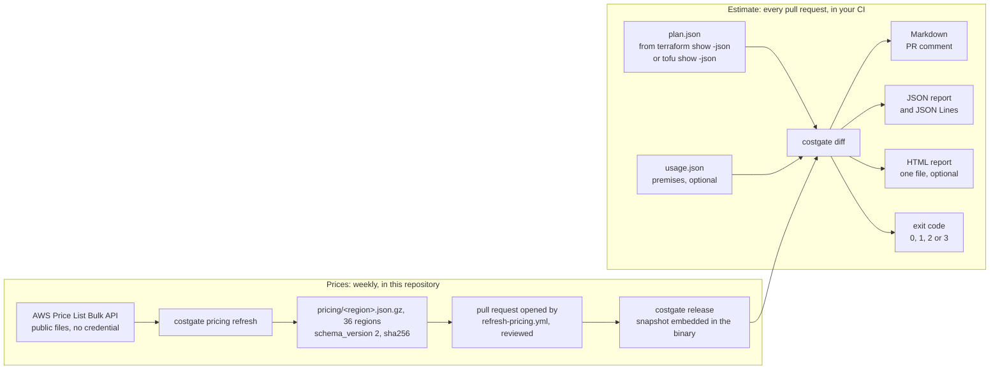
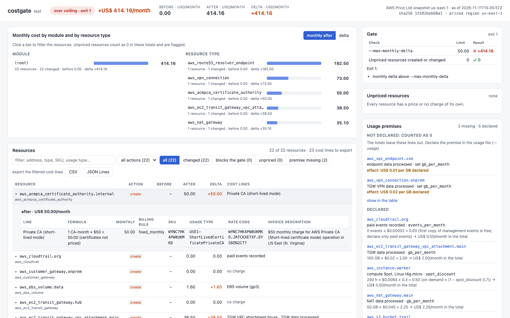

# costgate

[](https://github.com/leosavio/costgate/actions/workflows/ci.yml?query=branch%3Amain)
[](https://github.com/leosavio/costgate/releases)
[](LICENSE)
[](go.mod)

🇺🇸 English · 🇧🇷 [Português](README.pt-BR.md)

Monthly AWS cost projection of a `terraform plan` (or `tofu plan`), **before vs. after** per
resource, with a pull request gate: it exits with a distinct code when the delta exceeds a
ceiling or when a resource has no known price. Single Go binary, offline, no AWS credential, no SaaS.

- Prices come from **versioned snapshots** of the public [AWS Price List Bulk API](https://docs.aws.amazon.com/awsaccountbilling/latest/aboutv2/price-changes.html), one per region for all 36 regions (commercial and GovCloud), embedded in the binary. Each resource is priced in its own region. Price changes land through a PR with an auditable diff.
- **Fail-closed**: a created or changed resource the tool cannot price fails the check (exit 2). No unknown resource silently becomes "US$ 0".
- **Deterministic**: same input, same output byte for byte, on arm64 and amd64 (exact decimal arithmetic with `math/big`).
- Markdown output (PR comment), JSON and JSON Lines. Each cost line carries the keys of the AWS
  bill (SKU, usage type, rate code, invoice description), so it can be matched against the Cost
  and Usage Report.
- Optional [HTML report](#html-report): one self-contained file to audit a large plan offline,
  with filters and a CSV or JSON Lines export of the filtered lines.

Design decisions: [ADR-001](docs/adr/001-go-snapshot-bulk-api-e-fail-closed.md) (Go, Bulk API
snapshot, fail-closed; written in Portuguese).

## How it works



A weekly workflow turns the public AWS Price List into a versioned snapshot that ships inside the
binary. `costgate diff` reads only the plan JSON, the optional premises file and that snapshot: no
account, no network, no clock. The step-by-step path, the exit code logic and one resource priced
end to end are in [docs/how-it-works.md](docs/how-it-works.md).

## costgate and Infracost

Both read a Terraform or OpenTofu plan and comment the monthly cost on the pull request.
[Infracost](https://www.infracost.io) covers AWS, Azure and Google (over 1,100 resources), also
reads HCL without a plan, and adds guardrails, policies and dashboards in its paid Cloud plan; it
needs an Infracost login and queries its pricing API while estimating. costgate covers AWS only,
runs with no account and no network, fails the check on any resource it cannot price, and labels
each cost line with the keys of the AWS bill. Full table with sources, checked on 2026-11-04:
[docs/comparison.md](docs/comparison.md).

## Install

Homebrew (macOS and Linux), from the [`leosavio/homebrew-tap`](https://github.com/leosavio/homebrew-tap) tap:

```sh
brew install leosavio/tap/costgate
```

Homebrew 7.0.11 and later refuse formulae from non-official taps until you trust them. If
`brew install` stops with "Refusing to load formula ... from untrusted tap", run
`brew trust --formula leosavio/tap/costgate` and install again.

Go toolchain:

```sh
go install github.com/leosavio/costgate/cmd/costgate@latest
```

Release archive (darwin/linux, arm64/amd64), verifying the checksum and the keyless signature:

```sh
v=0.2.0; os=darwin; arch=arm64
base="https://github.com/leosavio/costgate/releases/download/v${v}"
curl -fsSLO "${base}/costgate_${v}_${os}_${arch}.tar.gz"
curl -fsSLO "${base}/checksums.txt"
curl -fsSLO "${base}/checksums.txt.sigstore.json"
cosign verify-blob --bundle checksums.txt.sigstore.json \
  --certificate-identity "https://github.com/leosavio/costgate/.github/workflows/release.yml@refs/tags/v${v}" \
  --certificate-oidc-issuer https://token.actions.githubusercontent.com checksums.txt
grep " costgate_${v}_${os}_${arch}.tar.gz\$" checksums.txt | shasum -a 256 -c -
tar -xzf "costgate_${v}_${os}_${arch}.tar.gz" costgate
```

On Linux, `sha256sum -c -` does the same as `shasum -a 256 -c -`.

### Tested platforms

| Platform | GitHub runner | `go test -race` + goldens (`ci.yml`) | Install smoke (`install-smoke.yml`) |
|---|---|---|---|
| linux/amd64 | `ubuntu-24.04` | native | brew · go install · tarball |
| linux/arm64 | `ubuntu-24.04-arm` | native | brew · go install · tarball |
| darwin/arm64 | `macos-15` | native | brew · go install · tarball |
| darwin/amd64 | `macos-15-intel` | native (Intel CPU, not Rosetta) | brew · go install · tarball |

[`install-smoke.yml`](.github/workflows/install-smoke.yml) installs a published release the way
a user does and runs after every release, every Tuesday and on demand
(`gh workflow run install-smoke.yml -f version=vX.Y.Z`). For each install path it checks that
`costgate version` matches the tag, that `costgate pricing verify` passes, and that the
`testdata/cases/baseline` case exits 1 with the golden Markdown
([`scripts/smoke-check.sh`](scripts/smoke-check.sh)).

### Verify your install

The script compares against the testdata of the tag you installed:

```sh
git clone -q --depth 1 --branch "v${v}" https://github.com/leosavio/costgate costgate-src && cd costgate-src
curl -fsSLO https://raw.githubusercontent.com/leosavio/costgate/main/scripts/smoke-check.sh
sh smoke-check.sh "$(command -v costgate)" "${v}"
# ok version: costgate 0.3.0
# ok us-east-1: 2684 prices, ...
# ok baseline: exit 1, ### costgate: ❌ +US$ 414.16/month · over ceiling
```

## Usage

```sh
terraform plan -out=tfplan
terraform show -json tfplan > plan.json      # tofu show -json works too

costgate diff --plan plan.json --usage costgate-usage.json --max-monthly-delta 10
costgate diff --plan - --format json < plan.json
```

| Flag | Default | Effect |
|---|---|---|
| `--plan` | required | `show -json` output of a **plan** (`-` reads stdin) |
| `--usage` | none | usage premises file (below) |
| `--max-monthly-delta` | no ceiling | exit 1 if `after − before` > value (USD/month) |
| `--max-monthly-total` | no ceiling | exit 1 if the total after the change > value; with an unpriced resource, exit 2 |
| `--region` | the only region the plan names, else `us-east-1` | region of the resources whose region the plan does not state; every other resource is priced in its own region, all 36 embedded ([Regions](#regions)) |
| `--pricing` | embedded | a snapshot file (`.json` or `.json.gz`, written by `pricing refresh`) used instead of the embedded one of its region; repeatable |
| `--ignore-provider` | none | comma-separated providers (`helm,kubectl,kubernetes`) left out of the estimate and the gate, and listed as ignored ([Providers other than AWS](#providers-other-than-aws)) |
| `--format` | `markdown` | `markdown` or `json` on stdout |
| `--markdown-out`, `--json-out` | — | also write to a file |
| `--json-lines` | — | also write one JSON document per cost line to a file ([JSON Lines](#json-lines)) |
| `--html-out` | — | also write a self-contained HTML report to a file ([HTML report](#html-report)); stdout and the exit code do not change |

| Exit | Meaning |
|---|---|
| 0 | everything priced and within the ceilings |
| 1 | above `--max-monthly-delta` or `--max-monthly-total` |
| 2 | a created, updated or replaced resource has no known price (takes precedence over 1: an incomplete estimate cannot prove the ceiling holds) |
| 3 | usage or input error: flag, invalid plan, state instead of plan, invalid premises or snapshot |

An unpriced resource in `no-op` or `delete` is reported but does not block: its delta is not
positive, and blocking would force an approval on every PR of a stack with a legacy resource
outside the map. Approval by label (`cost-approved`) belongs to the consumer; the tool only
returns the code. Example job: [docs/integration/github-actions.md](docs/integration/github-actions.md).

Each unpriced side carries a reason code in the JSON report (`unpriced_reason`): `provider` (not
the AWS provider), `type` (AWS type not in the pricing map), `region` (costgate has no price
snapshot of the resource region), `config` (a configuration not modeled, or a value unknown at
plan time) or `price` (the snapshot has no price for the key, such as an instance type it does
not list, or a product AWS does not sell in that region).

### Regions

The binary embeds a price snapshot of every region of the public AWS Price List: the 34
commercial regions and the 2 GovCloud regions (`costgate pricing regions` lists them, 1.8 MB of
gzip in total). Each resource is priced with the snapshot of its own region, so a plan that
spans regions (an ACM or KMS resource in us-east-1 for CloudFront, the application in sa-east-1)
is priced correctly without a flag. costgate takes the region of a resource from the first of:

1. the resource's `region` attribute (AWS provider 6.x adds it to every resource);
2. the region of its provider configuration, when the plan states it: a constant
   (`configuration.provider_config[...].expressions.region.constant_value`, aliases included) or
   a root module variable alone (`region = var.region`, whose value is in the plan's `variables`);
3. the region in the resource's ARN (`arn:<partition>:<service>:<region>:...`; global services
   such as IAM or S3 have an empty region and are skipped);
4. the region every other resource of the same provider configuration names through 1 or 3,
   when they all agree. This covers a resource without ARN (a NAT gateway) in a configuration
   with `region = local.region` or a module variable, which the plan does not resolve;
5. for the after side of a change, the region of its before side.

A resource for which none applies (a new resource, provider region from `AWS_REGION`) is priced
in the default region: `--region` when given, else the region of the only `--pricing` file, else
the only region the plan names, else `us-east-1`. When the caller did not choose it, the reports
start with a `region_assumed` warning that counts those resources and names the region used.

China regions (`cn-north-1`, `cn-northwest-1`) have their own Price List endpoint, prices in CNY,
and are not embedded; Local Zones and Wavelength Zones are priced as their parent region. A
resource in a region with no snapshot is **unpriced** with reason `region` (exit 2 when it is
created or changed, reported only for `no-op` and `delete`), and the Markdown, the JSON
(`warnings`) and the JSON Lines (`kind: costgate.warning`) start with a `region_mismatch`
warning that names the fix: `--pricing` with a snapshot of that region.

### Providers other than AWS

Resources of other providers (`helm_release`, `kubectl_manifest`, `kubernetes_*`...) have no AWS
price and are unpriced with reason `provider`, distinct from an AWS type outside the map (`type`).
By default they block like any unpriced resource. `--ignore-provider helm,kubectl,kubernetes`
leaves them out of the estimate and the gate; the report lists every ignored resource (Markdown
section and footer, JSON `ignored_providers` and `ignored`, JSON Lines `kind: costgate.ignored`).
An entry matches the provider source address or its last segments (`helm`, `hashicorp/helm`,
`registry.terraform.io/hashicorp/helm`). The AWS provider cannot be ignored (exit 3). Types with
no charge, such as `random_*` and `null_resource`, stay in the zero-cost list either way.

## Usage premises

The plan carries no volume (GB, hours running, Spot discount). The premises file is JSON,
versioned with the stack ([example](examples/usage.json)):

```json
{
  "schema_version": 1,
  "defaults": {"az_count": 2},
  "types": {"aws_nat_gateway": {"gb_per_month": 50}},
  "resources": {
    "aws_instance.worker": {"hours_per_month": 200, "spot_discount": 0.7},
    "module.net.aws_vpc_endpoint.ssm": {"gb_per_month": 10}
  }
}
```

| Field | Built-in default | Used for |
|---|---|---|
| `hours_per_month` | 730 | every hourly item (0–744) |
| `gb_per_month` | not declared (0, flagged) | NAT, endpoint and TGW data; S3 storage |
| `spot_discount` | 0 | Spot = on-demand × (1 − discount), 0 ≤ d < 1. The default 0 is the conservative ceiling |
| `events_per_month` | not declared (0, flagged) | paid CloudTrail events (the first copy of management events is free) |
| `az_count` | 2 | interface endpoint subnets when the plan does not know the count |
| `root_volume_gb` | 8 | instance root volume when the plan does not know the size |
| `extended_support_hours` | not declared (no line) | hours per month an `aws_eks_cluster` runs a Kubernetes version in extended support (0–744). costgate embeds no version calendar |
| `auto_mode_instance_hours` | not declared (0, flagged) | EKS Auto Mode: instance hours per month by instance type, `{"c6a.xlarge": 1460}`; priced with the Auto Mode management fee of each type |

Precedence, field by field: `resources["address[index]"]` > `resources["address"]` (without
`[index]`) > `types[type]` > `defaults` > built-in. A missing volume premise counts as 0 and is
listed in the report.

## Covered resources (us-east-1 snapshot of 2026-11-20)

The other regions have the same keys with their own prices and usage type prefix (`USW2-`,
`EU-`, `SAE1-`...). A product AWS does not sell in a region has no price there: the resource is
unpriced with reason `price`.

| Terraform type | Formula | SKU (usage type, operation) | Price (USD) |
|---|---|---|---|
| `aws_nat_gateway` | 730 h + GB | `NatGateway-Hours`, `NatGateway-Bytes` (`NatGateway`) | 0.045/h + 0.045/GB |
| `aws_eip`, `associate_public_ip_address` on `aws_instance` | 730 h per IP | `USE1-PublicIPv4:InUseAddress` | 0.005/h |
| `aws_vpc_endpoint` `Interface` (`Gateway` = 0) | 730 h × subnets + GB | `USE1-VpcEndpoint-Hours`, `-Bytes` (`VpcEndpoint`) | 0.01/h per AZ + 0.01/GB |
| `aws_ec2_transit_gateway_vpc_attachment` | 730 h + GB | `USE1-TransitGateway-Hours`, `-Bytes` (`TransitGatewayVPC`) | 0.05/h + 0.02/GB |
| `aws_ec2_transit_gateway_peering_attachment` | 730 h | `USE1-TransitGateway-Hours` (`TransitGatewayPeering`) | 0.05/h |
| `aws_vpn_connection` | 730 h; + attachment if `transit_gateway_id` | `VPN-Usage-Hours:ipsec.1`; `USE1-TransitGateway-Hours`/`-Bytes` (`TransitGatewayVPN`) | 0.05/h (+ 0.05/h + 0.02/GB) |
| `aws_route53_zone` | per zone-month | `HostedZone` (global offer) | 0.50 (first 25 zones tier) |
| `aws_route53_resolver_endpoint` | 730 h × `ip_address` count (min. 2) | `USE1-ResolverNetworkInterface` | 0.125/h per ENI |
| `aws_kms_key`, `aws_kms_replica_key`, `aws_kms_external_key`, `aws_kms_replica_external_key` | per key-month | `us-east-1-KMS-Keys` | 1.00 |
| `aws_instance`, `aws_spot_instance_request` | 730 h × instance price (Spot with discount) + root + `ebs_block_device` | `BoxUsage:<type>` (`RunInstances`, Linux, shared) — 1,396 types, x86 and Graviton | e.g. t3.micro 0.0104/h, t4g.micro 0.0084/h |
| `aws_ebs_volume`, instance volumes | GB-month | `EBS:VolumeUsage[.gp2/.gp3/.st1/.sc1]` | gp3 0.08, gp2 0.10, st1 0.045, sc1 0.015, standard 0.05 |
| gp3 volumes above the baseline | IOPS above 3000; (MiB/s above 125) ÷ 1024 | `EBS:VolumeP-IOPS.gp3` (IOPS-month), `EBS:VolumeP-Throughput.gp3` (GiBps-month) | 0.005 per IOPS; 40.96 per GiBps (0.04 per MiB/s) |
| `aws_eks_cluster` | 730 h control plane; + 730 h of the provisioned tier (`control_plane_scaling_config.tier`); + extended support hours and Auto Mode fee (premises) | `USE1-AmazonEKS-Hours:perCluster` (`CreateOperation`); `USE1-AmazonEKS-Hours:<XL\|2XL\|4XL\|8XL>-ProvisionedTier` (`ProvisionedControlPlaneUsage`); `USE1-AmazonEKS-Hours:extendedSupport` (`ExtendedSupport`); `EKS-Auto:<type>-management-hours` (`EKSAutoUsage`) — 1,261 types | 0.10/h; tier-xl + 1.65/h, 2xl + 3.40/h, 4xl + 6.90/h, 8xl + 13.90/h; + 0.50/h; c6a.xlarge 0.01836/h |
| `aws_eks_node_group` | `desired_size` × 730 h × first of `instance_types` (Spot with discount) + `disk_size` (default 20 GB, gp2) per node; Windows and `CUSTOM` AMIs unpriced | `BoxUsage:<type>`, `EBS:VolumeUsage.gp2` | e.g. m7g.large 0.0816/h |
| `aws_secretsmanager_secret` | per secret-month, + one per `replica` (at the primary region price); API requests not priced | `USE1-AWSSecretsManager-Secrets` | 0.40 |
| `aws_s3_bucket` | GB-month (premise) | `TimedStorage-ByteHrs` | 0.023 (first 50 TB) |
| `aws_cloudtrail` | paid events (premise) | `USE1-PaidEventsRecorded` | 0.00002 per event |
| `aws_acmpca_certificate_authority` | per CA-month by `usage_mode` | `USE1-PaidPrivateCA`, `USE1-ShortLivedCertificatePrivateCA` | 400 / 50 |
| `aws_acm_certificate` (public, not exportable), `aws_accessanalyzer_analyzer` (external access) | — | no charge | 0 |

Types without a charge of their own (VPC, subnet, routes, security groups, IAM, Organizations,
Identity Center, RAM, `aws_ec2_transit_gateway`, `aws_route53_record`, S3 bucket settings,
`random_*`, `time_*`…) are in the zero-cost list in
[`internal/estimate/resources.go`](internal/estimate/resources.go). Any other type is
**unpriced** (exit 2 when created or changed). Deliberately unpriced as well: regional NAT
gateway, `GatewayLoadBalancer`/`Resource` endpoints, EBS io1/io2, dedicated tenancy, `large` VPN
tunnels, CloudTrail with data events or Insights, EKS local clusters on Outposts and provisioned
control plane tiers (`control_plane_scaling_config.tier` other than `standard`), resources in
another region than the priced one ([Regions](#regions)), and `instance_type` unknown at plan time.

`aws_eks_cluster` prices the control plane at the standard support rate. The plan does not say
whether the Kubernetes version is in extended support on the billing dates, so the extended
support line exists only when `extended_support_hours` is declared. With
`compute_config.enabled = true` (EKS Auto Mode), AWS also bills a management fee per instance
hour of the nodes Auto Mode launches, which the plan does not carry: without
`auto_mode_instance_hours` the line counts 0 and is listed as an undeclared premise, as NAT data
without `gb_per_month`. The EC2 cost of those nodes is not estimated.

## Example PR comment

Generated from [`testdata/cases/changes`](testdata/cases/changes) with the embedded snapshot
(`costgate diff --plan plan.json --usage usage.json --max-monthly-delta 50`):

<!-- costgate -->
### costgate: ✅ -US$ 51.70/month · total US$ 21.82/month

| Monthly cost (USD) | Before | After | Delta |
|---|---:|---:|---:|
| Total | 73.52 | 21.82 | **-51.70** |

| Check | Limit | Result |
|---|---:|---|
| `--max-monthly-delta` | 50.00 | ✅ -51.70 |
| Unpriced resources created or changed | 0 | ✅ 0 |

#### Changed resources

| Resource | Action | Before | After | Delta | Breakdown |
|---|---|---:|---:|---:|---|
| `aws_ebs_volume.data` | update | 1.60 | 4.00 | +2.40 | EBS volume (gp3): 50 GB-month × $0.08 = 4.00 |
| `aws_eip.nat` | delete | 3.65 | – | -3.65 | public IPv4 address: 730 h × $0.005 = 3.65 |
| `aws_instance.app` | replace | 8.23 | 6.19 | -2.05 | compute Spot, Linux t4g.small: 730 h × $0.0168 × 0.4 = 4.91 (on-demand × (1 − spot_discount 0.6))<br>root volume (gp3): 16 GB-month × $0.08 = 1.28 |
| `aws_instance.batch` | update | 25.68 | 10.13 | -15.55 | compute on-demand, Linux t4g.small: 240 h × $0.0168 = 4.03<br>root volume (gp3): 20 GB-month × $0.08 = 1.60<br>ebs_block_device[0] (st1): 100 GB-month × $0.045 = 4.50 |
| `aws_nat_gateway.main` | delete | 32.85 | – | -32.85 | NAT gateway hours: 730 h × $0.045 = 32.85<br>NAT data processed: usage not declared (`gb_per_month`) |

<details><summary>Billing keys of 9 cost lines (SKU and invoice description)</summary>

| Resource | Line | SKU | Usage type | Billing rule | Invoice description |
|---|---|---|---|---|---|
| `aws_ebs_volume.data` | EBS volume (gp3) | `JG3KUJMBRGHV3N8G` | `EBS:VolumeUsage.gp3` | fixed_monthly | $0.08 per GB-month of General Purpose (gp3) provisioned storage - US East (N. Virginia) |
| `aws_eip.nat` | public IPv4 address | `4GQUNXTFWVSGPUZK` | `USE1-PublicIPv4:InUseAddress` | fixed_hourly | $0.005 per In-use public IPv4 address per hour |
| `aws_instance.app` | compute Spot, Linux t4g.small | `9GWX7R3VJUG9P8Y8` | `BoxUsage:t4g.small` | usage | $0.0168 per On Demand Linux t4g.small Instance Hour |
| `aws_instance.app` | root volume (gp3) | `JG3KUJMBRGHV3N8G` | `EBS:VolumeUsage.gp3` | fixed_monthly | $0.08 per GB-month of General Purpose (gp3) provisioned storage - US East (N. Virginia) |
| `aws_instance.batch` | compute on-demand, Linux t4g.small | `9GWX7R3VJUG9P8Y8` | `BoxUsage:t4g.small` | fixed_hourly | $0.0168 per On Demand Linux t4g.small Instance Hour |
| `aws_instance.batch` | root volume (gp3) | `JG3KUJMBRGHV3N8G` | `EBS:VolumeUsage.gp3` | fixed_monthly | $0.08 per GB-month of General Purpose (gp3) provisioned storage - US East (N. Virginia) |
| `aws_instance.batch` | ebs_block_device[0] (st1) | `YQT3C842QHBG6XCU` | `EBS:VolumeUsage.st1` | fixed_monthly | $0.045 per GB-month of Throughput Optimized HDD (st1) provisioned storage - US East (Northern Virginia) |
| `aws_nat_gateway.main` | NAT gateway hours | `M2YSHUBETB3JX4M4` | `NatGateway-Hours` | fixed_hourly | $0.045 per NAT Gateway Hour |
| `aws_nat_gateway.main` | NAT data processed | `59S5R83GFPUAGVR5` | `NatGateway-Bytes` | usage | $0.045 per GB Data Processed by NAT Gateways |

</details>

#### Usage premises not declared (counted as 0)

- `aws_nat_gateway.main`: NAT data processed, set `gb_per_month` in the usage file

<details><summary>1 changed resource with no charge</summary>

- `aws_route_table.private` (update)

</details>

<details><summary>2 unchanged priced resources</summary>

| Resource | Monthly |
|---|---:|
| `aws_kms_key.state` | 1.00 |
| `module.dns.aws_route53_zone.this["example.com"]` | 0.50 |

</details>

<sub>costgate 0.2.0 · AWS Price List Bulk API snapshot `us-east-1` as of 2026-11-03T00:09:47Z (sha256 `b27de59b0883`) · on-demand list prices, 730 h/month unless a premise overrides it · Savings Plans, Reserved Instances, credits, Free Tier and taxes are not included.</sub>

## JSON report

`--format json` (stdout) and `--json-out` (file) write the full report, `schema_version` 1. New
fields are only ever added within a `schema_version`; a removal or a change of meaning bumps it.
Each element of `resources[].before.lines` and `resources[].after.lines` is one cost line:

| Field | Since | Meaning |
|---|---|---|
| `name`, `unit`, `quantity`, `unit_price`, `factor`, `monthly` | 0.1.0 | the computation shown in the Breakdown column |
| `price_key` | 0.1.0 | `offer code\|usage type without region prefix\|operation`, the snapshot key |
| `premise`, `declared`, `note` | 0.1.0 | usage premise behind the quantity, and whether the usage file declared it |
| `sku` | 0.2.0 | Price List SKU, equal to `product_sku` in the CUR 2.0 |
| `usage_type` | 0.2.0 | raw usage type with the region prefix, as in the bill (`USE1-PublicIPv4:InUseAddress`, `us-east-1-KMS-Keys`; EC2 and S3 have no prefix in us-east-1) |
| `rate_code` | 0.2.0 | rate code of the tier the estimate uses (the first one), equal to `pricing_rate_code` in the CUR 2.0 |
| `billing_description` | 0.2.0 | price description, the text AWS prints on the invoice line |
| `billing_rule` | 0.2.0 | `fixed_hourly`, `fixed_monthly` or `usage` (below) |

| `billing_rule` | AWS bills | Lines |
|---|---|---|
| `fixed_hourly` | per hour the resource exists | NAT gateway, public IPv4, interface endpoint, TGW attachments, VPN, Resolver ENIs, on-demand instances, EKS control plane |
| `fixed_monthly` | per month the resource exists | hosted zone, KMS key, Private CA, provisioned EBS GB-month, gp3 IOPS and throughput above the baseline |
| `usage` | by traffic, stored data, events or market price; the quantity or the price is a premise | data processed, S3 storage, CloudTrail events, Spot instances, EKS extended support, EKS Auto Mode fee |

`fixed_*` lines are the ones expected to match the bill by SKU and quantity. The projection uses
730 h/month; the bill uses the hours of the calendar month, so monthly amounts differ even when
the line matches. With a snapshot written by costgate 0.1.x (`schema_version` 1), `usage_type`
and `rate_code` are empty strings. An undeclared EKS Auto Mode fee is the one line without a
price key: its SKU depends on the instance type the premise names, so `price_key`, `sku`,
`usage_type`, `rate_code` and `billing_description` are empty and `monthly` is 0.

Fields added in 0.3.0, absent when they do not apply:

| Field | Meaning |
|---|---|
| `resources[].before.unpriced_reason`, `resources[].after.unpriced_reason` | `provider`, `type`, `region`, `config` or `price` ([Usage](#usage)) |
| `warnings[]` | `{code, message, fix}`; codes `region_mismatch` and `region_assumed` ([Regions](#regions)) |
| `ignored_providers`, `ignored[]` | with `--ignore-provider`: the list given, and `{address, type, provider, action}` of each resource left out |

Fields added in 0.3.0 for per-region pricing, always present:

| Field | Meaning |
|---|---|
| `region` | the default region: the one of the resources whose region the plan does not state ([Regions](#regions)); `pricing` describes its snapshot |
| `snapshots[]` | `{region, as_of, sha256, resources}` of every snapshot that priced a resource, sorted by region |
| `resources[].region` | the region the resource is priced in; `region_assumed: true` when the plan does not state it |

In JSON Lines, `region`, `pricing_as_of` and `pricing_sha256` of a cost line are those of the
snapshot that priced it.

### JSON Lines

`--json-lines <file>` writes one compact JSON document per cost line and per side (`before`, then
`after`), in report order: the format the Athena JSON SerDe reads
([Athena: JSON](https://docs.aws.amazon.com/athena/latest/ug/parsing-json-data.html)) and `jq -c`
produces. Each document is standalone: it repeats `schema_version`, the costgate version, the
snapshot date and hash, and the resource address, type and action. Unpriced and zero-cost
resources have no cost line; they are only in the JSON report. Two other kinds appear only when
they apply: `costgate.warning` documents come first (one per warning) and `costgate.ignored`
documents last (one per resource of an `--ignore-provider` provider), so a query over cost
lines filters on `kind = 'costgate.line'`. One line of `testdata/cases/changes` with the
embedded snapshot:

```json
{"schema_version":1,"kind":"costgate.line","tool":"costgate","version":"0.2.0","region":"us-east-1","currency":"USD","pricing_as_of":"2026-11-03T00:09:47Z","pricing_sha256":"b27de59b08836c188cfa5bb1c758b2246392b90280def70f26d1c49f27daa0be","address":"module.dns.aws_route53_zone.this[\"example.com\"]","type":"aws_route53_zone","action":"no-op","side":"after","name":"hosted zone","price_key":"AmazonRoute53|HostedZone|","sku":"KVPGEJE88UW8S779","usage_type":"HostedZone","rate_code":"KVPGEJE88UW8S779.JRTCKXETXF.G2A93NZ7DT","billing_description":"$0.50 per Hosted Zone for the first 25 Hosted Zones","billing_rule":"fixed_monthly","unit_price":0.5,"quantity":1,"unit":"zone-month","monthly":0.5000,"declared":true,"note":"first-25-zones tier"}
```

## HTML report

```sh
costgate diff --plan plan.json --usage usage.json --max-monthly-delta 50 --html-out costgate.html
```

The Markdown comment is for deciding on a pull request in seconds. The HTML report is for
auditing a large plan: one file you open in a browser, with no server and no network.



| Section | What it shows |
|---|---|
| Header and gate | status and exit code, totals before, after and delta, each ceiling with its result, the reasons for the exit code, the snapshot region, `as_of` and sha256, the costgate version |
| Warnings | each `warnings[]` entry of the JSON report (`region_mismatch`, `region_assumed`) with its fix, above everything else; absent when there is none |
| Cost by module and by type | bars of the monthly cost after the change, or of the delta, per module (address prefix: `module.net`, `module.app["a"].module.db`, `(root)`) and per resource type; a click filters the table |
| Resources | filter by text (address, type, SKU, usage type, rate code), action, changed, blocking, unpriced or missing premise; a row opens its cost lines with the formula, `billing_rule`, SKU, usage type, rate code and invoice description, on each side |
| Unpriced resources | grouped by `unpriced_reason` (`provider`, `type`, `region`, `price`, `config`), each marked as blocking the gate or not |
| Usage premises | lines whose quantity is a premise: missing ones (counted as 0, with the cost of one unit) and declared ones (with their amount in the total) |
| Pricing regions | the default region and how it was chosen, every snapshot used with its date, sha256 and resource count, the region warnings and every resource unpriced for lack of a snapshot; with several regions, the table names the region of each resource |
| Ignored providers | with `--ignore-provider`: the providers given and each resource left out (address, type, provider, action) |
| Export | the cost lines of the filtered resources as CSV or JSON Lines, downloaded from the page; same fields and values as `--json-lines` |

The filters live in the URL fragment (`#type=aws_nat_gateway&show=changed`), so a filtered view can
be reloaded or shared with the file. The page has the same guarantees as the other outputs:

- **Same data as the JSON report**: the page embeds the JSON report of the run, encoded with
  `json.Marshal`, plus the amounts already formatted by costgate with exact decimals. The script
  does no arithmetic on money.
- **No network**: CSS and JavaScript are inline; the `Content-Security-Policy` is
  `default-src 'none'` and allows only the inline style and script by their sha256.
- **Plan strings are data**: they reach the page through `textContent`; an address such as
  `aws_s3_bucket.b["</script>"]` is shown as text
  ([`testdata/cases/escape`](testdata/cases/escape)).
- **Deterministic**: no clock (dates come from the snapshot), so the same plan and premises give the
  same bytes, on arm64 and amd64. The goldens are `testdata/cases/*/want.html`.

## Refreshing prices

```sh
costgate pricing regions                                                          # every supported region, embedded or not
costgate pricing refresh --region sa-east-1 --out sa-east-1.json.gz               # public HTTP, no credential
costgate pricing verify                                                           # every embedded snapshot
costgate pricing verify --pricing sa-east-1.json.gz                               # one file
bash scripts/refresh-all.sh                                                       # rebuild pricing/*.json.gz, 3 regions at a time
```

The refresh reads `offers/v1.0/aws/index.json`, downloads the CSV of every mapped service (the
EC2 one is ~300 MB in us-east-1 and is streamed) and keeps only the SKUs of the rules in
[`internal/catalog/rules.go`](internal/catalog/rules.go), with `schema_version`, the version and
date of each offer file, and a `sha256`. Two SKUs with different prices for one rule fail the
refresh. A rule with no price in a region (a product AWS does not sell there) is reported on
stderr and its keys are absent, so a resource that needs one is unpriced with reason `price`;
`--strict` makes it an error, and the weekly refresh runs us-east-1 with `--strict` to catch an
offer format change. The snapshot is written as gzip when `--out` ends in `.gz`; the same
snapshot always gives the same bytes (no name or time in the gzip header). The usage type prefix
of every region (`USE1-`, `EU-` for eu-west-1, `UGW1-` for us-gov-west-1...) is in `rules.go`.

The `refresh-pricing.yml` workflow runs every Monday, refreshes every region with
[`scripts/refresh-all.sh`](scripts/refresh-all.sh) (which keeps the file of a region whose prices
did not change) and opens
a PR only when a price changed: [`scripts/pricing-diff.sh`](scripts/pricing-diff.sh) compares the
`prices` maps with `main`, so a refresh that only moves `as_of`, `sha256` or the offer file
versions opens nothing (a rule change shows up as added or removed keys). Every refresh uses one
rolling branch, `pricing/refresh`, which the workflow rewrites and whose open PR it updates, with
the list of changed keys per region in the PR body.

The snapshot is `schema_version` 2 since costgate 0.2.0: each price also keeps the `rate_code`,
the raw `usage_type`, the `service_name` and `location` of the offer file, and the tiers after
the first one (`tiers`, for reference; the estimate uses the first tier). The snapshot is
embedded in the binary, so every release prices with its own copy; `--pricing` reads a file
instead.

| Binary | Embedded snapshot | `--pricing` file v1 | `--pricing` file v2 |
|---|---|---|---|
| 0.1.x | v1 | reads | refuses: `json: unknown field "rate_code"` (exit 3) |
| 0.2.x | v2 | reads; `usage_type` and `rate_code` empty | reads |

`Load` refuses unknown fields and any `schema_version` outside the range the build knows, so an
old binary never half-reads a newer snapshot. Since 0.2.0 it checks the version before the
fields, so a future v3 file fails with `schema_version 3 not supported` instead of the name of a
field.

To prove the PR path without touching `main` or the real snapshot, run the workflow in dry-run
mode:

```sh
gh workflow run refresh-pricing.yml -f dry_run_pr=true
```

It refreshes and tests as usual, then adds a synthetic `test_marker` field to the snapshot on a
throwaway branch `pricing/refresh-test-<run id>`, opens a PR labelled `pricing-refresh-test`,
checks that `github-actions[bot]` authored it, and closes the PR and deletes the branch in the
same run, also when a check fails. A real price change found during a dry run is not proposed;
the next weekly run picks it up.

A PR opened with `GITHUB_TOKEN` gets its `ci` run in an approval-required state
([GitHub docs](https://docs.github.com/en/actions/concepts/security/github_token)): approve it
from the PR before merging a real refresh. In a dry run that run cannot resolve its ref once the
branch is deleted and ends as a failure with no jobs, so the dry run records it in the job
summary and a separate job (the only one with `actions: write`) deletes it.

## Limitations

- **Variable usage is a premise**, not a measurement: data processed, hours running, events and
  storage are whatever the premises file says. Without a premise it counts as 0 and the report says so.
- **On-demand list prices**. Savings Plans, Reserved Instances, credits, Free Tier, negotiated
  discounts and taxes are excluded. Spot is `on-demand × (1 − spot_discount)`, not the current Spot
  price (which needs a credential and varies by AZ).
- Only the **first tier** of tiered prices is used (hosted zone: first 25; S3: 50 TB; endpoint:
  1 PB). The snapshot keeps the later tiers, and the bill may charge one of them because AWS
  counts the tier across the whole organization; compare `rate_code` with `pricing_rate_code`.
- No data transfer between AZs/regions/internet, requests (KMS, S3, Route 53 queries),
  certificates issued by the Private CA, or io1/io2 provisioned IOPS.
- Nodes that EKS Auto Mode or Karpenter launch are not in the plan: their EC2 and EBS cost is not
  estimated, and their Auto Mode fee only through `auto_mode_instance_hours`.
- Linux on shared tenancy only; Windows/RHEL/SUSE AMIs are priced as Linux (the plan does not say
  which OS the AMI runs).
- When the plan does not know an endpoint's subnet list (`subnet_ids` from another resource),
  `az_count` is used. Auto Scaling groups and launch templates are not resolved yet:
  `aws_autoscaling_group` is unpriced.
- Per-resource values are rounded for display; totals use the exact sum, so `after − before` of a
  row may differ by 0.01 from its Delta column.
- Regions are priced at the region level: a resource in a Local Zone or Wavelength Zone gets the
  price of its parent region, which can be lower than the zone's. China regions are not
  embedded (another Price List endpoint, prices in CNY).
- A resource whose region the plan does not state (a new resource with the provider region from
  `AWS_REGION`) is priced in the default region and counted in the `region_assumed` warning.

## Development

```sh
go vet ./... && staticcheck ./... && go test -race ./...
go test ./internal/cli -update      # rewrite testdata/ golden files (review the diff)
bash scripts/html-check.sh          # open each golden HTML report in headless Chrome
```

Short guide: [CONTRIBUTING.md](CONTRIBUTING.md). License: [MIT](LICENSE).
