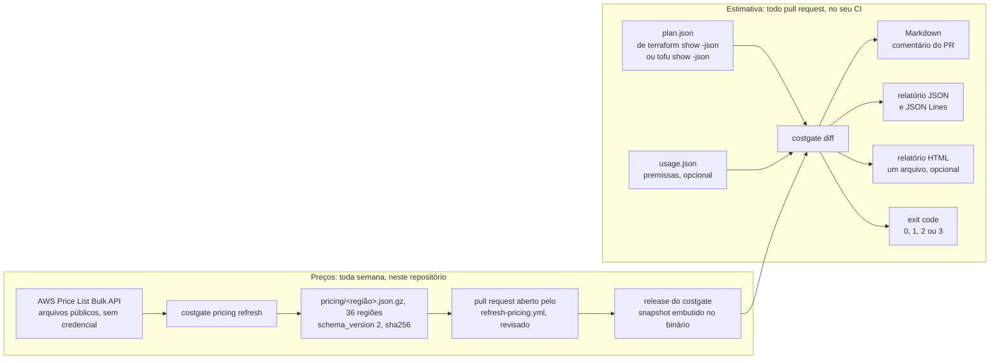
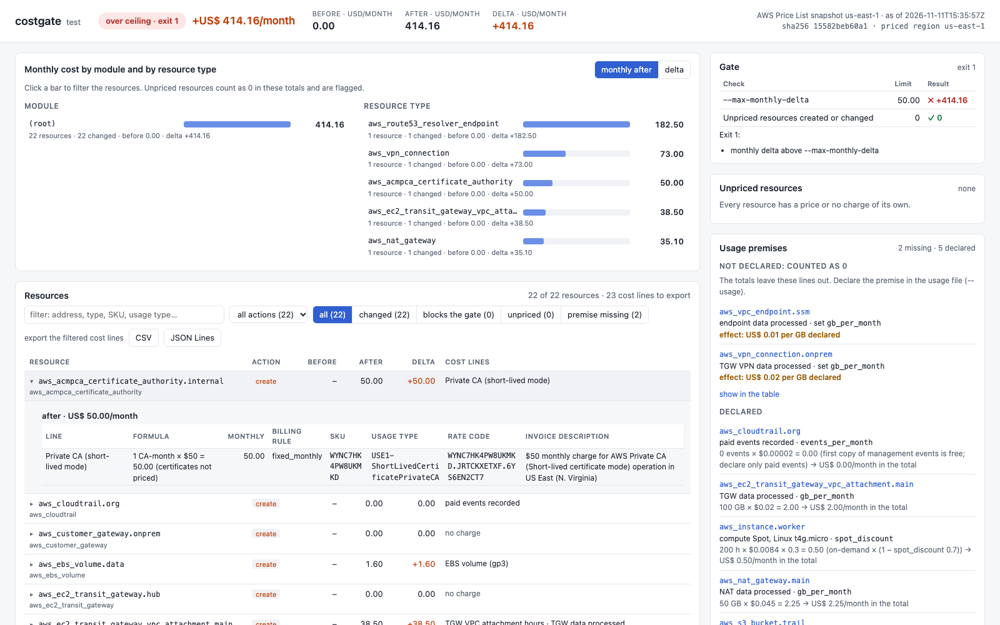

# costgate

[](https://github.com/leosavio/costgate/actions/workflows/ci.yml?query=branch%3Amain)
[](https://github.com/leosavio/costgate/releases)
[](LICENSE)
[](go.mod)

🇺🇸 [English](README.md) (versão oficial) · 🇧🇷 Português

> Tradução do `README.md`. Em caso de divergência, vale a versão em inglês.

Projeção do custo mensal da AWS de um `terraform plan` (ou `tofu plan`), **antes × depois** por
recurso, com gate de PR: sai com código distinto quando o delta passa do teto ou quando aparece
recurso sem preço conhecido. Binário único em Go, offline, sem credencial AWS e sem SaaS.

- Preços vêm de **snapshots versionados** da [AWS Price List Bulk API](https://docs.aws.amazon.com/awsaccountbilling/latest/aboutv2/price-changes.html) pública, um por região para as 36 regiões (comerciais e GovCloud), embutidos no binário. Cada recurso é precificado na sua região. Mudança de preço entra por PR, com diff auditável.
- **Fail-closed**: recurso criado ou alterado que a ferramenta não sabe precificar falha o check (exit 2). Nenhum recurso desconhecido vira "US$ 0" em silêncio.
- **Determinístico**: mesma entrada, mesma saída byte a byte, em arm64 e amd64 (aritmética decimal exata com `math/big`).
- Saída em Markdown (comentário de PR), JSON e JSON Lines. Cada linha de custo traz as chaves da
  fatura da AWS (SKU, usage type, rate code, descrição da fatura), para casar com o Cost and Usage
  Report.
- [Relatório HTML](#relatório-html) opcional: um arquivo autocontido para auditar um plan grande
  offline, com filtros e exportação em CSV ou JSON Lines das linhas filtradas.

Decisões: [ADR-001 (Go, snapshot da Bulk API e fail-closed)](docs/adr/001-go-snapshot-bulk-api-e-fail-closed.md).

## Como funciona



Um workflow semanal transforma a Price List pública da AWS num snapshot versionado que vai dentro do
binário. O `costgate diff` lê só o plan JSON, o arquivo opcional de premissas e esse snapshot: sem
conta, sem rede, sem relógio. O caminho passo a passo, a lógica do exit code e um recurso
precificado de ponta a ponta estão em [docs/how-it-works.md](docs/how-it-works.md) (em inglês).

## costgate e Infracost

Os dois leem um plan do Terraform ou do OpenTofu e comentam o custo mensal no pull request. O
[Infracost](https://www.infracost.io) cobre AWS, Azure e Google (mais de 1.100 recursos), também lê
HCL sem plan e soma guardrails, policies e dashboards no plano pago Cloud; exige login no Infracost
e consulta a API de preços dele durante a estimativa. O costgate cobre só AWS, roda sem conta e sem
rede, falha o check em qualquer recurso que não sabe precificar e marca cada linha de custo com as
chaves da fatura da AWS. Tabela completa com fontes, conferida em 2026-11-04:
[docs/comparison.md](docs/comparison.md) (em inglês).

## Instalação

Release (darwin/linux, arm64/amd64), com verificação de checksum e assinatura keyless:

```sh
v=0.2.0; os=darwin; arch=arm64
base="https://github.com/leosavio/costgate/releases/download/v${v}"
curl -fsSLO "${base}/costgate_${v}_${os}_${arch}.tar.gz"
curl -fsSLO "${base}/checksums.txt"
curl -fsSLO "${base}/checksums.txt.sigstore.json"
cosign verify-blob --bundle checksums.txt.sigstore.json \
  --certificate-identity "https://github.com/leosavio/costgate/.github/workflows/release.yml@refs/tags/v${v}" \
  --certificate-oidc-issuer https://token.actions.githubusercontent.com checksums.txt
grep " costgate_${v}_${os}_${arch}.tar.gz\$" checksums.txt | shasum -a 256 -c -
tar -xzf "costgate_${v}_${os}_${arch}.tar.gz" costgate
```

No Linux, `sha256sum -c -` faz o mesmo que `shasum -a 256 -c -`.

Homebrew (macOS e Linux), pelo tap [`leosavio/homebrew-tap`](https://github.com/leosavio/homebrew-tap):

```sh
brew install leosavio/tap/costgate
```

O Homebrew 7.0.11 em diante recusa fórmula de tap não oficial até ela ser confiada. Se o
`brew install` parar com "Refusing to load formula ... from untrusted tap", rode
`brew trust --formula leosavio/tap/costgate` e instale de novo.

Com Go instalado: `go install github.com/leosavio/costgate/cmd/costgate@latest`.

### Plataformas testadas

| Plataforma | Runner do GitHub | `go test -race` + goldens (`ci.yml`) | Smoke de instalação (`install-smoke.yml`) |
|---|---|---|---|
| linux/amd64 | `ubuntu-24.04` | nativo | brew · go install · tarball |
| linux/arm64 | `ubuntu-24.04-arm` | nativo | brew · go install · tarball |
| darwin/arm64 | `macos-15` | nativo | brew · go install · tarball |
| darwin/amd64 | `macos-15-intel` | nativo (CPU Intel, não Rosetta) | brew · go install · tarball |

O [`install-smoke.yml`](.github/workflows/install-smoke.yml) instala uma release publicada como o
usuário faria e roda após cada release, toda terça e sob demanda
(`gh workflow run install-smoke.yml -f version=vX.Y.Z`). Em cada caminho confere que
`costgate version` bate com a tag, que `costgate pricing verify` passa e que o caso
`testdata/cases/baseline` sai com exit 1 e o Markdown do golden
([`scripts/smoke-check.sh`](scripts/smoke-check.sh)).

### Verificar a instalação

O script compara com o testdata da tag instalada:

```sh
git clone -q --depth 1 --branch "v${v}" https://github.com/leosavio/costgate costgate-src && cd costgate-src
curl -fsSLO https://raw.githubusercontent.com/leosavio/costgate/main/scripts/smoke-check.sh
sh smoke-check.sh "$(command -v costgate)" "${v}"
# ok version: costgate 0.2.0
# ok us-east-1: 1415 prices, ...
# ok baseline: exit 1, ### costgate: ❌ +US$ 414.16/month · over ceiling
```

## Uso

```sh
terraform plan -out=tfplan
terraform show -json tfplan > plan.json      # tofu show -json também serve

costgate diff --plan plan.json --usage costgate-usage.json --max-monthly-delta 10
costgate diff --plan - --format json < plan.json
```

| Flag | Padrão | Efeito |
|---|---|---|
| `--plan` | obrigatório | saída de `show -json` de um **plan** (`-` lê do stdin) |
| `--usage` | nenhum | arquivo de premissas de uso (abaixo) |
| `--max-monthly-delta` | sem teto | exit 1 se `depois − antes` > valor (USD/mês) |
| `--max-monthly-total` | sem teto | exit 1 se o total depois da mudança > valor; com recurso não precificado, exit 2 |
| `--region` | a única região que o plan cita, senão `us-east-1` | região dos recursos cuja região o plan não informa; os demais são precificados na própria região, as 36 embutidas ([Regiões](#regiões)) |
| `--pricing` | embutido | arquivo de snapshot (`.json` ou `.json.gz`, gerado por `pricing refresh`) usado no lugar do embutido da sua região; repetível |
| `--ignore-provider` | nenhum | providers separados por vírgula (`helm,kubectl,kubernetes`) deixados fora da estimativa e do gate, e listados como ignorados ([Providers que não são AWS](#providers-que-não-são-aws)) |
| `--format` | `markdown` | `markdown` ou `json` no stdout |
| `--markdown-out`, `--json-out` | — | grava também em arquivo |
| `--json-lines` | — | grava também um documento JSON por linha de custo ([JSON Lines](#json-lines)) |
| `--html-out` | — | grava também um relatório HTML autocontido em arquivo ([Relatório HTML](#relatório-html)); stdout e exit code não mudam |

| Exit | Significado |
|---|---|
| 0 | tudo precificado e dentro dos tetos |
| 1 | acima de `--max-monthly-delta` ou `--max-monthly-total` |
| 2 | recurso criado, alterado ou substituído sem preço conhecido (tem precedência sobre 1) |
| 3 | erro de uso ou de entrada: flag, plan inválido, state no lugar de plan, premissa ou snapshot inválido |

Recurso não precificado em `no-op` ou `delete` aparece no relatório mas não bloqueia: o delta dele
não é positivo. A liberação por label (`cost-approved`) é do consumidor; a ferramenta só devolve o
código. Job de exemplo: [docs/integration/github-actions.md](docs/integration/github-actions.md).

Cada lado não precificado traz um código de motivo no relatório JSON (`unpriced_reason`):
`provider` (não é o provider AWS), `type` (tipo AWS fora do mapa de preços), `region` (o costgate
não tem snapshot de preços da região do recurso), `config` (configuração não modelada, ou valor
desconhecido no plan) ou `price` (o snapshot não tem preço para a chave, como um tipo de instância
que ele não lista, ou um produto que a AWS não vende naquela região).

### Regiões

O binário embute um snapshot de preços de toda região da AWS Price List pública: as 34 regiões
comerciais e as 2 do GovCloud (`costgate pricing regions` lista, 1,8 MB de gzip no total). Cada
recurso é precificado com o snapshot da sua região, então um plan que abrange várias regiões (um
recurso ACM ou KMS em us-east-1 para o CloudFront, a aplicação em sa-east-1) sai certo sem flag.
O costgate usa a primeira fonte que responder:

1. o atributo `region` do recurso (o AWS provider 6.x o adiciona a todo recurso);
2. a região da configuração de provider do recurso, quando o plan a informa: uma constante
   (`configuration.provider_config[...].expressions.region.constant_value`, aliases incluídos) ou
   uma variável do módulo raiz sozinha (`region = var.region`, cujo valor está em `variables` no
   plan);
3. a região do ARN do recurso (`arn:<partição>:<serviço>:<região>:...`; serviços globais como IAM
   ou S3 têm a região vazia e são ignorados);
4. a região que todos os outros recursos da mesma configuração de provider indicam pelas fontes 1
   ou 3, quando concordam. Cobre um recurso sem ARN (um NAT gateway) numa configuração com
   `region = local.region` ou variável de módulo, que o plan não resolve;
5. para o lado depois de uma mudança, a região do lado antes.

Recurso sem nenhuma dessas fontes (recurso novo, região do provider vinda de `AWS_REGION`) é
precificado na região padrão: `--region` quando informado, senão a região do único arquivo
`--pricing`, senão a única região que o plan cita, senão `us-east-1`. Quando quem chamou não
escolheu a região, os relatórios começam com um aviso `region_assumed` que conta esses recursos e
diz a região usada.

As regiões da China (`cn-north-1`, `cn-northwest-1`) têm endpoint próprio da Price List, preços em
CNY, e não vêm embutidas; Local Zones e Wavelength Zones são precificadas como a região-mãe.
Recurso numa região sem snapshot fica **não precificado** com motivo `region` (exit 2 se criado ou
alterado, só relatado em `no-op` e `delete`), e o Markdown, o JSON (`warnings`) e o JSON Lines
(`kind: costgate.warning`) começam com um aviso `region_mismatch` que diz a correção: `--pricing`
com um snapshot daquela região.

### Providers que não são AWS

Recursos de outros providers (`helm_release`, `kubectl_manifest`, `kubernetes_*`...) não têm preço
AWS e ficam não precificados com motivo `provider`, separado de um tipo AWS fora do mapa (`type`).
Por padrão bloqueiam como qualquer recurso não precificado. `--ignore-provider
helm,kubectl,kubernetes` os deixa fora da estimativa e do gate; o relatório lista cada recurso
ignorado (seção e rodapé do Markdown, `ignored_providers` e `ignored` no JSON, `kind:
costgate.ignored` no JSON Lines). Uma entrada casa com o endereço de origem do provider ou com os
últimos segmentos dele (`helm`, `hashicorp/helm`, `registry.terraform.io/hashicorp/helm`). O
provider AWS não pode ser ignorado (exit 3). Tipos sem cobrança, como `random_*` e
`null_resource`, continuam na lista de custo zero nos dois casos.

## Premissas de uso

O plan não traz volume (GB, horas ligadas, desconto Spot). O arquivo de premissas é JSON,
versionado junto com a stack ([exemplo](examples/usage.json)):

```json
{
  "schema_version": 1,
  "defaults": {"az_count": 2},
  "types": {"aws_nat_gateway": {"gb_per_month": 50}},
  "resources": {
    "aws_instance.worker": {"hours_per_month": 200, "spot_discount": 0.7},
    "module.net.aws_vpc_endpoint.ssm": {"gb_per_month": 10}
  }
}
```

| Campo | Padrão embutido | Uso |
|---|---|---|
| `hours_per_month` | 730 | todo item por hora (0–744) |
| `gb_per_month` | não declarado (0, sinalizado) | dados de NAT, endpoint e TGW; armazenamento S3 |
| `spot_discount` | 0 | Spot = on-demand × (1 − desconto), 0 ≤ d < 1. O padrão 0 é o teto conservador |
| `events_per_month` | não declarado (0, sinalizado) | eventos pagos do CloudTrail (a 1ª cópia de management events é grátis) |
| `az_count` | 2 | subnets de interface endpoint quando o plan não sabe a contagem |
| `root_volume_gb` | 8 | volume raiz de instância quando o plan não sabe o tamanho |
| `extended_support_hours` | não declarado (sem linha) | horas por mês em que um `aws_eks_cluster` roda uma versão do Kubernetes em suporte estendido (0–744). O costgate não embute calendário de versões |
| `auto_mode_instance_hours` | não declarado (0, sinalizado) | EKS Auto Mode: horas de instância por mês por tipo, `{"c6a.xlarge": 1460}`; precificado com a taxa de gestão do Auto Mode de cada tipo |

Precedência, campo a campo: `resources["endereço[índice]"]` > `resources["endereço"]` (sem
`[índice]`) > `types[tipo]` > `defaults` > embutido. Premissa de volume não declarada conta 0 e é
listada no relatório.

## Recursos cobertos (snapshot us-east-1 de 2026-11-20)

As outras regiões têm as mesmas chaves, com preços e prefixo de usage type próprios (`USW2-`,
`EU-`, `SAE1-`...). Produto que a AWS não vende numa região não tem preço lá: o recurso fica não
precificado com motivo `price`.

| Tipo Terraform | Fórmula | SKU (usage type, operação) | Preço |
|---|---|---|---|
| `aws_nat_gateway` | 730 h + GB | `NatGateway-Hours`, `NatGateway-Bytes` (`NatGateway`) | 0,045/h + 0,045/GB |
| `aws_eip`, `associate_public_ip_address` em `aws_instance` | 730 h por IP | `USE1-PublicIPv4:InUseAddress` | 0,005/h |
| `aws_vpc_endpoint` `Interface` (`Gateway` = 0) | 730 h × nº de subnets + GB | `USE1-VpcEndpoint-Hours`, `-Bytes` (`VpcEndpoint`) | 0,01/h por AZ + 0,01/GB |
| `aws_ec2_transit_gateway_vpc_attachment` | 730 h + GB | `USE1-TransitGateway-Hours`, `-Bytes` (`TransitGatewayVPC`) | 0,05/h + 0,02/GB |
| `aws_ec2_transit_gateway_peering_attachment` | 730 h | `USE1-TransitGateway-Hours` (`TransitGatewayPeering`) | 0,05/h |
| `aws_vpn_connection` | 730 h; + attachment se `transit_gateway_id` | `VPN-Usage-Hours:ipsec.1`; `USE1-TransitGateway-Hours`/`-Bytes` (`TransitGatewayVPN`) | 0,05/h (+ 0,05/h + 0,02/GB) |
| `aws_route53_zone` | por zona/mês | `HostedZone` (offer global) | 0,50 (faixa das 25 primeiras) |
| `aws_route53_resolver_endpoint` | 730 h × nº de `ip_address` (mín. 2) | `USE1-ResolverNetworkInterface` | 0,125/h por ENI |
| `aws_kms_key`, `aws_kms_replica_key`, `aws_kms_external_key`, `aws_kms_replica_external_key` | por chave/mês | `us-east-1-KMS-Keys` | 1,00 |
| `aws_instance`, `aws_spot_instance_request` | 730 h × preço do tipo (Spot com desconto) + raiz + `ebs_block_device` | `BoxUsage:<tipo>` (`RunInstances`, Linux, shared) — 1 396 tipos, x86 e Graviton | ex.: t3.micro 0,0104/h, t4g.micro 0,0084/h |
| `aws_ebs_volume`, volumes de instância | GB-mês | `EBS:VolumeUsage[.gp2/.gp3/.st1/.sc1]` | gp3 0,08, gp2 0,10, st1 0,045, sc1 0,015, standard 0,05 |
| volumes gp3 acima da base | IOPS acima de 3000; (MiB/s acima de 125) ÷ 1024 | `EBS:VolumeP-IOPS.gp3` (IOPS-mês), `EBS:VolumeP-Throughput.gp3` (GiBps-mês) | 0,005 por IOPS; 40,96 por GiBps (0,04 por MiB/s) |
| `aws_eks_cluster` | 730 h de control plane; + horas de suporte estendido e taxa do Auto Mode (premissas) | `USE1-AmazonEKS-Hours:perCluster` (`CreateOperation`); `USE1-AmazonEKS-Hours:extendedSupport` (`ExtendedSupport`); `EKS-Auto:<tipo>-management-hours` (`EKSAutoUsage`) — 1 261 tipos | 0,10/h; + 0,50/h; c6a.xlarge 0,01836/h |
| `aws_s3_bucket` | GB-mês (premissa) | `TimedStorage-ByteHrs` | 0,023 (primeiros 50 TB) |
| `aws_cloudtrail` | eventos pagos (premissa) | `USE1-PaidEventsRecorded` | 0,00002 por evento |
| `aws_acmpca_certificate_authority` | por CA/mês conforme `usage_mode` | `USE1-PaidPrivateCA`, `USE1-ShortLivedCertificatePrivateCA` | 400 / 50 |
| `aws_acm_certificate` (público, não exportável), `aws_accessanalyzer_analyzer` (external access) | — | sem cobrança | 0 |

Tipos sem custo próprio (VPC, subnet, rotas, security groups, IAM, Organizations, Identity
Center, RAM, `aws_ec2_transit_gateway`, `aws_route53_record`, configurações de bucket S3,
`random_*`, `time_*`…) estão na lista de custo zero em
[`internal/estimate/resources.go`](internal/estimate/resources.go). Qualquer outro tipo é **não
precificado** (exit 2 se criado ou alterado). Caso também não precificado, por decisão: NAT
regional, endpoint `GatewayLoadBalancer`/`Resource`, EBS io1/io2, tenancy dedicada, VPN de túnel
`large`, CloudTrail com data events ou Insights, cluster EKS local em Outposts e tiers de control
plane provisionado (`control_plane_scaling_config.tier` diferente de `standard`), recurso em outra
região que a precificada ([Regiões](#regiões)), `instance_type` desconhecido no plan.

`aws_eks_cluster` precifica o control plane na tarifa de suporte padrão. O plan não diz se a
versão do Kubernetes estará em suporte estendido nas datas de cobrança, então a linha de suporte
estendido só existe com `extended_support_hours` declarado. Com `compute_config.enabled = true`
(EKS Auto Mode), a AWS também cobra uma taxa de gestão por hora de instância dos nós que o Auto
Mode cria, que o plan não traz: sem `auto_mode_instance_hours` a linha conta 0 e aparece como
premissa não declarada, como os dados do NAT sem `gb_per_month`. O custo EC2 desses nós não é
estimado.

## Exemplo de comentário de PR

Gerado de [`testdata/cases/changes`](testdata/cases/changes) com o snapshot embutido
(`costgate diff --plan plan.json --usage usage.json --max-monthly-delta 50`):

<!-- costgate -->
### costgate: ✅ -US$ 51.70/month

| Monthly cost (USD) | Before | After | Delta |
|---|---:|---:|---:|
| Total | 73.52 | 21.82 | **-51.70** |

| Check | Limit | Result |
|---|---:|---|
| `--max-monthly-delta` | 50.00 | ✅ -51.70 |
| Unpriced resources created or changed | 0 | ✅ 0 |

#### Changed resources

| Resource | Action | Before | After | Delta | Breakdown |
|---|---|---:|---:|---:|---|
| `aws_ebs_volume.data` | update | 1.60 | 4.00 | +2.40 | EBS volume (gp3): 50 GB-month × $0.08 = 4.00 |
| `aws_eip.nat` | delete | 3.65 | – | -3.65 | public IPv4 address: 730 h × $0.005 = 3.65 |
| `aws_instance.app` | replace | 8.23 | 6.19 | -2.05 | compute Spot, Linux t4g.small: 730 h × $0.0168 × 0.4 = 4.91 (on-demand × (1 − spot_discount 0.6))<br>root volume (gp3): 16 GB-month × $0.08 = 1.28 |
| `aws_instance.batch` | update | 25.68 | 10.13 | -15.55 | compute on-demand, Linux t4g.small: 240 h × $0.0168 = 4.03<br>root volume (gp3): 20 GB-month × $0.08 = 1.60<br>ebs_block_device[0] (st1): 100 GB-month × $0.045 = 4.50 |
| `aws_nat_gateway.main` | delete | 32.85 | – | -32.85 | NAT gateway hours: 730 h × $0.045 = 32.85<br>NAT data processed: usage not declared (`gb_per_month`) |

<details><summary>Billing keys of 9 cost lines (SKU and invoice description)</summary>

| Resource | Line | SKU | Usage type | Billing rule | Invoice description |
|---|---|---|---|---|---|
| `aws_ebs_volume.data` | EBS volume (gp3) | `JG3KUJMBRGHV3N8G` | `EBS:VolumeUsage.gp3` | fixed_monthly | $0.08 per GB-month of General Purpose (gp3) provisioned storage - US East (N. Virginia) |
| `aws_eip.nat` | public IPv4 address | `4GQUNXTFWVSGPUZK` | `USE1-PublicIPv4:InUseAddress` | fixed_hourly | $0.005 per In-use public IPv4 address per hour |
| `aws_instance.app` | compute Spot, Linux t4g.small | `9GWX7R3VJUG9P8Y8` | `BoxUsage:t4g.small` | usage | $0.0168 per On Demand Linux t4g.small Instance Hour |
| `aws_instance.app` | root volume (gp3) | `JG3KUJMBRGHV3N8G` | `EBS:VolumeUsage.gp3` | fixed_monthly | $0.08 per GB-month of General Purpose (gp3) provisioned storage - US East (N. Virginia) |
| `aws_instance.batch` | compute on-demand, Linux t4g.small | `9GWX7R3VJUG9P8Y8` | `BoxUsage:t4g.small` | fixed_hourly | $0.0168 per On Demand Linux t4g.small Instance Hour |
| `aws_instance.batch` | root volume (gp3) | `JG3KUJMBRGHV3N8G` | `EBS:VolumeUsage.gp3` | fixed_monthly | $0.08 per GB-month of General Purpose (gp3) provisioned storage - US East (N. Virginia) |
| `aws_instance.batch` | ebs_block_device[0] (st1) | `YQT3C842QHBG6XCU` | `EBS:VolumeUsage.st1` | fixed_monthly | $0.045 per GB-month of Throughput Optimized HDD (st1) provisioned storage - US East (Northern Virginia) |
| `aws_nat_gateway.main` | NAT gateway hours | `M2YSHUBETB3JX4M4` | `NatGateway-Hours` | fixed_hourly | $0.045 per NAT Gateway Hour |
| `aws_nat_gateway.main` | NAT data processed | `59S5R83GFPUAGVR5` | `NatGateway-Bytes` | usage | $0.045 per GB Data Processed by NAT Gateways |

</details>

#### Usage premises not declared (counted as 0)

- `aws_nat_gateway.main`: NAT data processed, set `gb_per_month` in the usage file

<details><summary>1 changed resource with no charge</summary>

- `aws_route_table.private` (update)

</details>

<details><summary>2 unchanged priced resources</summary>

| Resource | Monthly |
|---|---:|
| `aws_kms_key.state` | 1.00 |
| `module.dns.aws_route53_zone.this["example.com"]` | 0.50 |

</details>

<sub>costgate 0.2.0 · AWS Price List Bulk API snapshot `us-east-1` as of 2026-11-03T00:09:47Z (sha256 `b27de59b0883`) · on-demand list prices, 730 h/month unless a premise overrides it · Savings Plans, Reserved Instances, credits, Free Tier and taxes are not included.</sub>

## Relatório JSON

`--format json` (stdout) e `--json-out` (arquivo) gravam o relatório completo, `schema_version` 1.
Dentro de um `schema_version` só entram campos novos; remover campo ou mudar significado sobe a
versão. Cada elemento de `resources[].before.lines` e `resources[].after.lines` é uma linha de custo:

| Campo | Desde | Significado |
|---|---|---|
| `name`, `unit`, `quantity`, `unit_price`, `factor`, `monthly` | 0.1.0 | a conta mostrada na coluna Breakdown |
| `price_key` | 0.1.0 | `offer code\|usage type sem prefixo de região\|operation`, chave do snapshot |
| `premise`, `declared`, `note` | 0.1.0 | premissa de uso por trás da quantidade e se o arquivo de premissas a declarou |
| `sku` | 0.2.0 | SKU da Price List, igual ao `product_sku` do CUR 2.0 |
| `usage_type` | 0.2.0 | usage type bruto, com prefixo de região, como na fatura (`USE1-PublicIPv4:InUseAddress`, `us-east-1-KMS-Keys`; EC2 e S3 não têm prefixo em us-east-1) |
| `rate_code` | 0.2.0 | rate code da faixa usada na estimativa (a primeira), igual ao `pricing_rate_code` do CUR 2.0 |
| `billing_description` | 0.2.0 | descrição do preço, o texto que a AWS imprime na linha da fatura |
| `billing_rule` | 0.2.0 | `fixed_hourly`, `fixed_monthly` ou `usage` (abaixo) |

| `billing_rule` | A AWS cobra | Linhas |
|---|---|---|
| `fixed_hourly` | por hora em que o recurso existe | NAT gateway, IPv4 pública, endpoint interface, attachments de TGW, VPN, ENIs do Resolver, instância on-demand, control plane do EKS |
| `fixed_monthly` | por mês em que o recurso existe | hosted zone, chave KMS, Private CA, GB-mês provisionado de EBS, IOPS e throughput do gp3 acima da base |
| `usage` | por tráfego, dado armazenado, evento ou preço de mercado; a quantidade ou o preço é premissa | dado processado, armazenamento S3, eventos do CloudTrail, instância Spot, suporte estendido do EKS, taxa do EKS Auto Mode |

As linhas `fixed_*` são as que devem casar com a fatura por SKU e quantidade. A projeção usa
730 h/mês; a fatura usa as horas do mês do calendário, então o valor mensal difere mesmo quando a
linha casa. Com snapshot gravado pelo costgate 0.1.x (`schema_version` 1), `usage_type` e
`rate_code` saem como string vazia. A taxa do EKS Auto Mode não declarada é a única linha sem
chave de preço: o SKU depende do tipo de instância que a premissa nomeia, então `price_key`,
`sku`, `usage_type`, `rate_code` e `billing_description` saem vazios e `monthly` é 0.

Campos adicionados depois da 0.2.0 (sem release), todos ausentes quando não se aplicam, então um
relatório sem eles é byte a byte o da 0.2.0:

| Campo | Significado |
|---|---|
| `resources[].before.unpriced_reason`, `resources[].after.unpriced_reason` | `provider`, `type`, `region`, `config` ou `price` ([Uso](#uso)) |
| `warnings[]` | `{code, message, fix}`; códigos `region_mismatch` e `region_assumed` ([Regiões](#regiões)) |
| `ignored_providers`, `ignored[]` | com `--ignore-provider`: a lista passada, e `{address, type, provider, action}` de cada recurso deixado de fora |

Campos da precificação por região (não lançados), sempre presentes:

| Campo | Significado |
|---|---|
| `region` | a região padrão: a dos recursos cuja região o plan não informa ([Regiões](#regiões)); `pricing` descreve o snapshot dela |
| `snapshots[]` | `{region, as_of, sha256, resources}` de cada snapshot que precificou algum recurso, em ordem de região |
| `resources[].region` | a região em que o recurso é precificado; `region_assumed: true` quando o plan não a informa |

No JSON Lines, `region`, `pricing_as_of` e `pricing_sha256` de uma linha de custo são os do
snapshot que a precificou.

### JSON Lines

`--json-lines <arquivo>` grava um documento JSON compacto por linha de custo e por lado (`before`,
depois `after`), na ordem do relatório: o formato que o JSON SerDe do Athena lê
([Athena: JSON](https://docs.aws.amazon.com/athena/latest/ug/parsing-json-data.html)) e que
`jq -c` produz. Cada documento é autocontido: repete `schema_version`, a versão do costgate, data e
hash do snapshot, e endereço, tipo e ação do recurso. Recurso não precificado ou de custo zero não
tem linha de custo; aparece só no relatório JSON. Dois outros kinds aparecem só quando se
aplicam: documentos `costgate.warning` vêm primeiro (um por aviso) e `costgate.ignored` por último
(um por recurso de provider em `--ignore-provider`), então uma consulta sobre linhas de custo
filtra por `kind = 'costgate.line'`. Uma linha de `testdata/cases/changes` com o snapshot
embutido:

```json
{"schema_version":1,"kind":"costgate.line","tool":"costgate","version":"0.2.0","region":"us-east-1","currency":"USD","pricing_as_of":"2026-11-03T00:09:47Z","pricing_sha256":"b27de59b08836c188cfa5bb1c758b2246392b90280def70f26d1c49f27daa0be","address":"module.dns.aws_route53_zone.this[\"example.com\"]","type":"aws_route53_zone","action":"no-op","side":"after","name":"hosted zone","price_key":"AmazonRoute53|HostedZone|","sku":"KVPGEJE88UW8S779","usage_type":"HostedZone","rate_code":"KVPGEJE88UW8S779.JRTCKXETXF.G2A93NZ7DT","billing_description":"$0.50 per Hosted Zone for the first 25 Hosted Zones","billing_rule":"fixed_monthly","unit_price":0.5,"quantity":1,"unit":"zone-month","monthly":0.5000,"declared":true,"note":"first-25-zones tier"}
```

## Relatório HTML

```sh
costgate diff --plan plan.json --usage usage.json --max-monthly-delta 50 --html-out costgate.html
```

O comentário em Markdown serve para decidir um pull request em segundos. O relatório HTML serve
para auditar um plan grande: um arquivo que se abre no navegador, sem servidor e sem rede.



| Seção | O que mostra |
|---|---|
| Cabeçalho e gate | status e exit code, totais antes, depois e delta, cada teto com o resultado, os motivos do exit code, região, `as_of` e sha256 do snapshot, versão do costgate |
| Avisos | cada item de `warnings[]` do relatório JSON (`region_mismatch`, `region_assumed`) com a correção, acima de tudo; some quando não há aviso |
| Custo por módulo e por tipo | barras do custo mensal depois da mudança, ou do delta, por módulo (prefixo do endereço: `module.net`, `module.app["a"].module.db`, `(root)`) e por tipo de recurso; o clique filtra a tabela |
| Recursos | filtro por texto (endereço, tipo, SKU, usage type, rate code), ação, alterados, que bloqueiam, não precificados ou com premissa faltando; a linha abre as linhas de custo com fórmula, `billing_rule`, SKU, usage type, rate code e descrição da fatura, de cada lado |
| Recursos não precificados | agrupados por `unpriced_reason` (`provider`, `type`, `region`, `price`, `config`), cada um marcado como bloqueia ou não bloqueia o gate |
| Premissas de uso | linhas cuja quantidade é premissa: as que faltam (contadas como 0, com o custo de uma unidade) e as declaradas (com o valor no total) |
| Regiões de preço | a região padrão e como foi escolhida, cada snapshot usado com data, sha256 e número de recursos, os avisos de região e todo recurso não precificado por falta de snapshot; com várias regiões, a tabela diz a região de cada recurso |
| Providers ignorados | com `--ignore-provider`: os providers passados e cada recurso deixado de fora (endereço, tipo, provider, ação) |
| Exportar | as linhas de custo dos recursos filtrados em CSV ou JSON Lines, baixadas pela própria página; mesmos campos e valores do `--json-lines` |

Os filtros ficam no fragmento da URL (`#type=aws_nat_gateway&show=changed`), então uma visão
filtrada pode ser recarregada ou compartilhada junto com o arquivo. A página tem as mesmas garantias
das outras saídas:

- **Mesmos dados do relatório JSON**: a página embute o relatório JSON da execução, codificado com
  `json.Marshal`, mais os valores já formatados pelo costgate com decimal exato. O script não faz
  conta com dinheiro.
- **Sem rede**: CSS e JavaScript inline; a `Content-Security-Policy` é `default-src 'none'` e só
  libera o estilo e o script inline pelo sha256 de cada um.
- **Texto do plan é dado**: entra na página por `textContent`; um endereço como
  `aws_s3_bucket.b["</script>"]` aparece como texto
  ([`testdata/cases/escape`](testdata/cases/escape)).
- **Determinístico**: sem relógio (as datas vêm do snapshot), então o mesmo plan com as mesmas
  premissas gera os mesmos bytes, em arm64 e amd64. Os goldens são `testdata/cases/*/want.html`.

## Atualizar preços

```sh
costgate pricing regions                                                          # toda região suportada, embutida ou não
costgate pricing refresh --region sa-east-1 --out sa-east-1.json.gz               # HTTP público, sem credencial
costgate pricing verify                                                           # todo snapshot embutido
costgate pricing verify --pricing sa-east-1.json.gz                               # um arquivo
bash scripts/refresh-all.sh                                                       # regrava pricing/*.json.gz, 3 regiões por vez
```

O refresh lê `offers/v1.0/aws/index.json`, baixa o CSV de cada serviço mapeado (o do EC2 tem
~300 MB em us-east-1 e é lido em streaming) e grava só os SKUs das regras de
[`internal/catalog/rules.go`](internal/catalog/rules.go), com `schema_version`, versão e data de
cada offer file e `sha256`. Dois SKUs com preços diferentes para uma regra falham o refresh. Regra
sem preço numa região (produto que a AWS não vende lá) é avisada no stderr e suas chaves ficam de
fora, então um recurso que precisa dela fica não precificado com motivo `price`; `--strict` torna
isso um erro, e o refresh semanal roda us-east-1 com `--strict` para pegar mudança de formato da
offer file. O snapshot é gravado em gzip quando `--out` termina em `.gz`; o mesmo snapshot sempre
gera os mesmos bytes (sem nome nem hora no cabeçalho do gzip). O prefixo de usage type de cada
região (`USE1-`, `EU-` para eu-west-1, `UGW1-` para us-gov-west-1...) está em `rules.go`.

O workflow `refresh-pricing.yml` roda toda segunda, atualiza toda região com
[`scripts/refresh-all.sh`](scripts/refresh-all.sh) (que mantém o arquivo da região cujos preços não
mudaram) e abre PR só
quando algum preço mudou: [`scripts/pricing-diff.sh`](scripts/pricing-diff.sh) compara os mapas
`prices` com a `main`, então um refresh que só muda `as_of`, `sha256` ou as versões das offer files
não abre nada (mudança de regra aparece como chave adicionada ou removida). Todo refresh usa uma
branch única, `pricing/refresh`, que o workflow reescreve e cujo PR aberto ele atualiza, com a lista
de chaves alteradas por região no corpo do PR.

O snapshot é `schema_version` 2 desde o costgate 0.2.0: cada preço guarda também `rate_code`,
`usage_type` bruto, `service_name` e `location` da offer file, e as faixas depois da primeira
(`tiers`, para referência; a estimativa usa a primeira faixa). O snapshot vai embutido no binário,
então cada release precifica com a própria cópia; `--pricing` lê um arquivo no lugar.

| Binário | Snapshot embutido | Arquivo `--pricing` v1 | Arquivo `--pricing` v2 |
|---|---|---|---|
| 0.1.x | v1 | lê | recusa: `json: unknown field "rate_code"` (exit 3) |
| 0.2.x | v2 | lê; `usage_type` e `rate_code` vazios | lê |

O `Load` recusa campo desconhecido e `schema_version` fora da faixa que o build conhece, então
binário antigo nunca lê pela metade um snapshot mais novo. Desde a 0.2.0 ele confere a versão antes
dos campos, então um arquivo v3 futuro falha com `schema_version 3 not supported` em vez do nome de
um campo.

Para provar o caminho do PR sem tocar `main` nem o snapshot real, rode em modo de teste:

```sh
gh workflow run refresh-pricing.yml -f dry_run_pr=true
```

O run faz o refresh e os testes normais, adiciona um campo sintético `test_marker` ao snapshot
numa branch descartável `pricing/refresh-test-<run id>`, abre PR com label `pricing-refresh-test`,
confere que o autor é `github-actions[bot]` e, no mesmo run, fecha o PR e apaga a branch (também
quando uma verificação falha). Mudança real de preço achada num dry run não vira PR; o próximo run
semanal a pega.

PR aberto com `GITHUB_TOKEN` recebe o run de `ci` em estado de aprovação pendente
([doc do GitHub](https://docs.github.com/en/actions/concepts/security/github_token)): aprove pelo
PR antes de fazer merge de um refresh real. No dry run esse run não resolve mais o ref depois que a
branch é apagada e termina como falha sem jobs; o dry run registra o run no resumo do job e um job
separado (o único com `actions: write`) o apaga.

## Limitações

- **Uso variável é premissa**, não medição: GB processado, horas ligadas, eventos e
  armazenamento valem o que o arquivo de premissas diz. Sem premissa, conta 0 e o relatório avisa.
- Preço de **lista on-demand**. Savings Plans, Reserved Instances, créditos, Free Tier, descontos
  negociados e impostos ficam fora. Spot é `on-demand × (1 − spot_discount)`, não o preço Spot
  do momento (que exige credencial e varia por AZ).
- Só a **primeira faixa** de preço escalonado entra na conta (hosted zone: 25 primeiras; S3: 50 TB;
  endpoint: 1 PB). O snapshot guarda as faixas seguintes, e a fatura pode cobrar uma delas porque a
  AWS conta a faixa na organização inteira; compare `rate_code` com `pricing_rate_code`.
- Não cobre transferência de dados entre AZs/regiões/internet, requisições (KMS, S3, Route 53
  queries), certificados emitidos pela Private CA, nem IOPS provisionado de io1/io2.
- Nós que o EKS Auto Mode ou o Karpenter criam não estão no plan: o custo EC2 e EBS deles não é
  estimado, e a taxa do Auto Mode só entra via `auto_mode_instance_hours`.
- Só Linux em tenancy compartilhada; AMI Windows/RHEL/SUSE é precificada como Linux (o plan não diz
  o sistema operacional da AMI).
- Quando o plan não conhece a lista de subnets de um endpoint (`subnet_ids` vindo de outro
  recurso), usa `az_count`. ASG e launch template ainda não são resolvidos: `aws_autoscaling_group`
  é não precificado.
- Valores por recurso são arredondados para exibição; os totais usam a soma exata, então
  `depois − antes` de uma linha pode diferir 0,01 da coluna Delta.
- A precificação é por região: recurso numa Local Zone ou Wavelength Zone recebe o preço da
  região-mãe, que pode ser menor que o da zona. As regiões da China não vêm embutidas (outro
  endpoint da Price List, preços em CNY).
- Recurso cuja região o plan não informa (recurso novo com a região do provider vinda de
  `AWS_REGION`) é precificado na região padrão e contado no aviso `region_assumed`.

## Desenvolvimento

```sh
go vet ./... && staticcheck ./... && go test -race ./...
go test ./internal/cli -update      # regrava golden files de testdata/ (revise o diff)
bash scripts/html-check.sh          # abre cada relatório HTML golden no Chrome headless
```

Guia curto: [CONTRIBUTING.md](CONTRIBUTING.md) (em inglês). Licença: [MIT](LICENSE).
