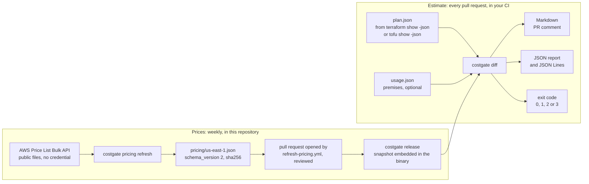
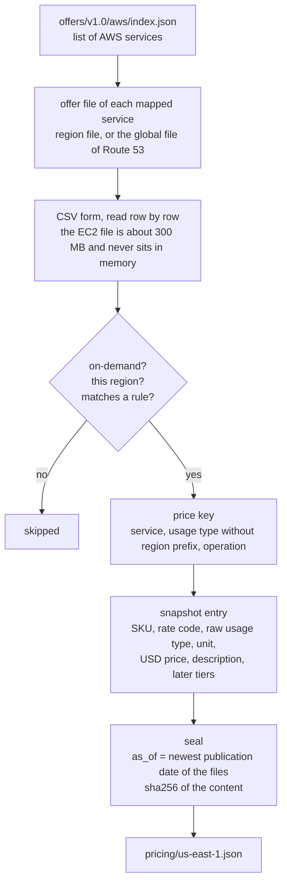
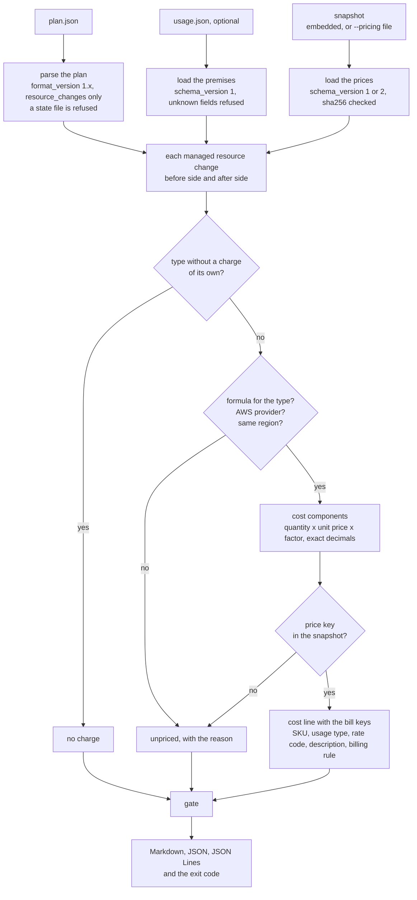
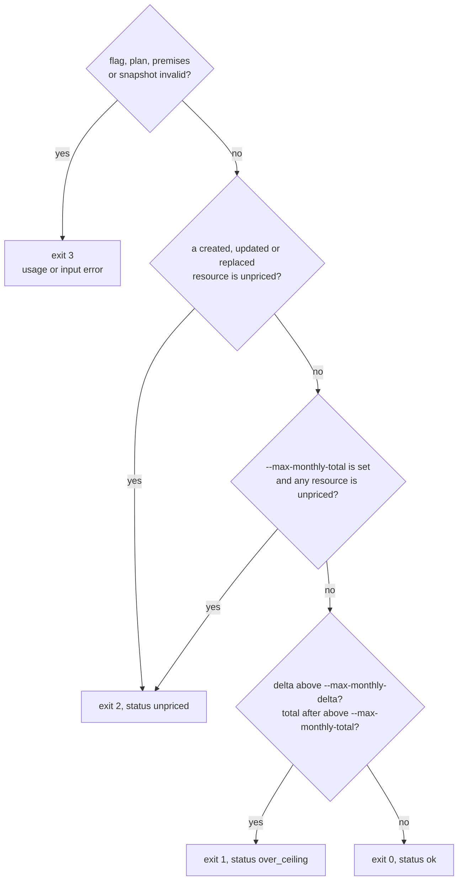
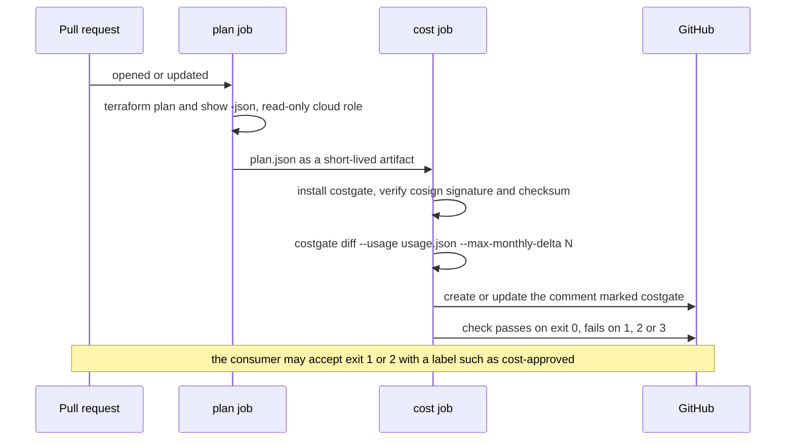

# How costgate works

costgate turns the JSON of a Terraform or OpenTofu plan into a monthly cost before and after the
change, per resource, and returns an exit code that a CI job can gate on. This page follows the
data from the AWS price list to the pull request comment. Flags and output formats are in the
[README](../README.md); design decisions are in
[ADR-001](adr/001-go-snapshot-bulk-api-e-fail-closed.md) (in Portuguese). How costgate compares
with Infracost: [comparison.md](comparison.md).

## The big picture

Two things happen at different times. Prices are extracted once a week, in this repository, and
ship inside the binary. The estimate runs on every pull request, in your CI, with only the plan,
the optional premises file and the embedded prices.



What `costgate diff` never does:

| Never | Consequence |
|---|---|
| Call an AWS account, or any API with a credential | the cost job holds no cloud secret |
| Use the network | the job can run without egress; prices are already in the binary |
| Read the clock, depend on map order or on the host | same input, same bytes on Linux and macOS, arm64 and amd64 |
| Read Terraform state | state holds sensitive values in clear text; the parser refuses a state file |
| Send data anywhere | output goes only to stdout and to the files you name |

The only command that uses the network is `costgate pricing refresh`, and it only downloads public
files.

## 1. Price snapshot (`costgate pricing refresh`)



1. The refresh reads the public index of the
   [AWS Price List Bulk API](https://docs.aws.amazon.com/awsaccountbilling/latest/aboutv2/price-changes.html)
   and, for each service named in [`internal/catalog/rules.go`](../internal/catalog/rules.go),
   downloads the CSV form of the offer file for the region.
2. Each row is kept only if it is an on-demand price of that region and matches a rule: service,
   usage type, operation, and extra columns where needed (EC2 instances must be Linux, shared
   tenancy, no pre-installed software).
3. The usage type is compared without its region prefix, because the Price List is not
   consistent: EC2 in us-east-1 has no prefix, VPC uses `USE1-`, KMS uses `us-east-1-`. The raw
   value is still stored, because the AWS bill uses it.
4. The entry keeps what the bill needs to recognize the line: SKU, rate code, raw usage type,
   service name, location and the description AWS prints on the invoice. The first tier is the
   price the estimate uses; later tiers are stored for reference.
5. The refresh fails instead of writing an incomplete file when a rule matches no row (AWS renamed
   something), when two different rows claim the same price key, or when a price is not in USD.
6. `as_of` is the newest publication date among the offer files, not the time of the run, and
   `sha256` covers the content. Editing the file by hand breaks the hash, and every command that
   loads the file refuses it.
7. The weekly [`refresh-pricing.yml`](../.github/workflows/refresh-pricing.yml) runs the tests
   against the new file and opens a pull request when the file changed. After the merge, the next
   release embeds the file with `go:embed`.

One entry of the real snapshot:

```json
"AmazonEC2|NatGateway-Hours|NatGateway": {
  "sku": "M2YSHUBETB3JX4M4",
  "unit": "Hrs",
  "usd": "0.0450000000",
  "description": "$0.045 per NAT Gateway Hour",
  "rate_code": "M2YSHUBETB3JX4M4.JRTCKXETXF.6YS6EN2CT7",
  "usage_type": "NatGateway-Hours",
  "service_name": "Amazon Elastic Compute Cloud",
  "location": "US East (N. Virginia)"
}
```

## 2. The estimate (`costgate diff`)



### Inputs

| Input | What is read | What is refused (exit 3) |
|---|---|---|
| Plan, from `terraform show -json <planfile>` or `tofu show -json` | `format_version` and, for each entry of `resource_changes`: address, mode, type, provider, actions, `before`, `after`, `after_unknown` | a state file (no `planned_values` nor `resource_changes`), a `format_version` other than 1.x, an unknown list of actions |
| Premises file (`--usage`) | per-field values for hours, GB, Spot discount, events, AZ count, root volume size | `schema_version` other than 1, unknown fields, values out of range (hours above 744, Spot discount of 1 or more, negative values) |
| Price snapshot | the embedded file of `--region`, or `--pricing <file>` | wrong `sha256`, unknown fields, `schema_version` outside 1 to 2, currency other than USD, region different from `--region` |

Data sources (`mode = data`) and `read` actions are skipped. Each action decides which sides exist:
`create` has only an after side, `delete` only a before side, `update` and `replace` (delete and
create in either order) have both. `forget` removes the resource from Terraform but not from the
account, so both sides keep the current cost and the delta is 0.

### Premises

The plan has no volume: data processed, hours running, events, Spot discount. Each field is
resolved separately, in this order, and the first one that sets it wins:

| Order | Source | Example |
|---|---|---|
| 1 | `resources["<address with index>"]` | `resources["aws_instance.web[0]"]` |
| 2 | `resources["<address without index>"]` | `resources["aws_instance.web"]` |
| 3 | `types["<resource type>"]` | `types["aws_nat_gateway"]` |
| 4 | `defaults` | `defaults.az_count` |
| 5 | built in | 730 hours, Spot discount 0, 2 AZs, 8 GB root volume |

GB and events have no built-in value: they count as 0 and the report lists them as "not
declared", so a missing premise is visible.

### Pricing each resource

For each side of each resource:

1. A type in the zero-cost list (VPC, subnets, routes, security groups, IAM, Organizations…)
   costs nothing and needs no price.
2. A type without a formula in [`internal/estimate/resources.go`](../internal/estimate/resources.go),
   a resource of another provider, or one whose `region` differs from `--region` is **unpriced**,
   with the reason. So is a configuration the formula does not model (gp3 above 3000 IOPS,
   regional NAT gateway, CloudTrail data events…).
3. Otherwise the formula returns cost components. Each component is
   `quantity × unit price × factor`: 730 hours of a NAT gateway, 50 GB of data from the premises,
   1 hosted zone per month, an on-demand price times `1 − spot_discount` for Spot.
4. Each component looks up its price key in the snapshot. A missing key makes the side unpriced;
   a found key adds a cost line with the bill keys of that price.
5. All arithmetic uses exact decimals (`math/big`), never floating point. Values are rounded only
   when rendered.

Each line also gets a `billing_rule`: `fixed_hourly` (billed per hour the resource exists),
`fixed_monthly` (per month: hosted zone, KMS key, Private CA, provisioned EBS GB-month) or `usage`
(traffic, stored data, events, Spot market price). The `fixed_*` lines are the ones expected to
match the AWS bill by SKU and quantity; `usage` lines depend on premises.

### The gate



An incomplete estimate cannot prove that a ceiling holds, so exit 2 takes precedence over exit 1.
An unpriced resource that is only kept (`no-op`) or deleted does not block by itself: its delta is
not positive, and blocking would force an approval on every pull request of a stack with an old
resource outside the map. With `--max-monthly-total` it does block, because the total is then
incomplete. costgate only returns the code; accepting exit 1 or 2 (for example with a
`cost-approved` label) is a rule of the CI that calls it.

### Outputs

| Output | Content |
|---|---|
| Markdown (stdout by default, `--markdown-out`) | first line `<!-- costgate -->`, so a CI job can find and update its own comment; totals, checks, one row per changed resource with the formula, a collapsed block with the bill keys of each cost line, unpriced resources and their reasons, premises not declared, and a footer with the costgate version and the snapshot date and hash |
| JSON report (`--format json`, `--json-out`) | the same data for machines, `schema_version` 1 |
| JSON Lines (`--json-lines`) | one standalone document per cost line, for Athena, `jq` or any line-oriented tool |
| Exit code | 0, 1, 2 or 3, as above |

The report lists resource addresses as they appear in the plan, including `for_each` keys, and the
attribute values that a formula or an unpriced reason uses (instance type, volume type, region,
counts). No other attribute of the plan is copied to the output.

## 3. One resource, end to end

`aws_nat_gateway.main` in [`testdata/cases/baseline`](../testdata/cases/baseline), with the
premises file of that case (`types.aws_nat_gateway.gb_per_month = 50`):

| Step | Value |
|---|---|
| Plan | address `aws_nat_gateway.main`, actions `["create"]`: only an after side; `availability_mode` is not `regional`, so the zonal formula applies |
| Formula | one hourly component and one data-processed component |
| Premises | 730 hours (built in); 50 GB (`types` entry of the premises file) |
| Price keys | `AmazonEC2`, `NatGateway-Hours`, `NatGateway` and `AmazonEC2`, `NatGateway-Bytes`, `NatGateway` |
| Snapshot | SKU `M2YSHUBETB3JX4M4`, US$ 0.045 per hour; SKU `59S5R83GFPUAGVR5`, US$ 0.045 per GB |
| Cost lines | `730 h × $0.045 = 32.85` (`fixed_hourly`); `50 GB × $0.045 = 2.25` (`usage`, premise `gb_per_month`) |
| Resource | before –, after 35.10, delta +35.10 |
| Gate | the case also sets `--max-monthly-delta 50`; the whole plan adds US$ 414.16 per month, so the run exits 1 |

The same hourly line in the JSON report:

```json
{"name":"NAT gateway hours","price_key":"AmazonEC2|NatGateway-Hours|NatGateway","sku":"M2YSHUBETB3JX4M4","usage_type":"NatGateway-Hours","rate_code":"M2YSHUBETB3JX4M4.JRTCKXETXF.6YS6EN2CT7","billing_description":"$0.045 per NAT Gateway Hour","billing_rule":"fixed_hourly","unit_price":0.045,"quantity":730,"unit":"h","monthly":32.8500,"declared":true}
```

In the AWS Cost and Usage Report (CUR 2.0), this line should be found by `product_sku`,
`line_item_usage_type` and `pricing_rate_code`. The amount differs: the projection uses 730 hours
per month, the bill uses the hours of the calendar month.

## 4. In a CI pipeline



The plan job is the only one with a cloud credential, and only to plan. The cost job has no cloud
credential: it needs the plan JSON and permission to comment. The plan JSON carries account IDs
and may carry sensitive values, so keep the artifact short-lived and out of comments. A complete
job is in [integration/github-actions.md](integration/github-actions.md).

## 5. Determinism

| Rule | How |
|---|---|
| Money never uses `float64` | fused multiply-add can round differently on arm64 and amd64; `math/big.Rat` is exact everywhere |
| Output order is fixed | resources in plan order, lines in formula order, JSON fields in a fixed order |
| No clock | `as_of` comes from the offer files |
| Proven in CI | the golden files in `testdata/` are compared byte for byte on native Linux and macOS runners, arm64 and amd64 |

The same costgate version with the same plan and premises gives the same output on any machine,
today or a year from now, because the prices travel with the binary.
